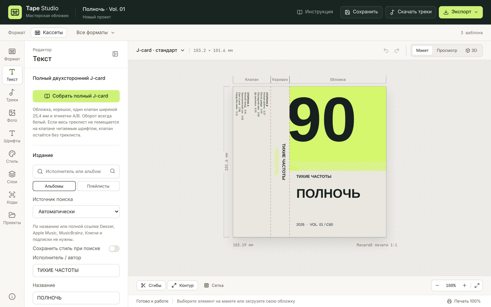

#  Tape Studio

Редактор кассетных J-card, O-card и этикеток с печатью в натуральную величину. Работает в браузере и как приложение для Windows.

[Открыть мастерскую](https://igneelhd.github.io/tape-studio/) · [Скачать для Windows](https://github.com/IgneelHD/tape-studio/releases/latest)



## Что умеет

- Форматы: J-card (клапан 25,4 мм, корешок 12,7 мм, лицевая часть 65,0875 × 101,6 мм), Cassingle · O-card и этикетка кассеты A/B (89 × 41 мм).
- Редактор: текст, треки сторон A и B, изображения, шрифты, слои, QR, EAN13 и CODE128.
- «Собрать полный J-card»: обложка, корешок, клапан с треклистом и этикетки A/B. Пропорции обложки сохраняются, цвета и шрифты подбираются локально. Если треклист не помещается на клапане читаемым шрифтом, клапан остаётся без него. Оборот всегда белый.
- Поиск альбомов в Deezer, iTunes и MusicBrainz, плейлистов в Deezer.
- Скачивание свободного аудио из Internet Archive и Wikimedia Commons в ZIP с источниками и лицензиями. Записи без свободной лицензии не скачиваются.
- Экспорт в PDF 1:1, PNG, пустой шаблон PDF, буфер обмена и JSON. Для печати выбирайте масштаб 100%.
- 3D-просмотр собранного футляра.

Каталоги и аудио запрашиваются напрямую из браузера, без сервера. Если источник не отвечает или блокирует запрос (CORS), смените источник или загрузите изображение вручную.

## Хранение данных

Проекты, изображения и шрифты хранятся в этом браузере (IndexedDB). Аккаунт и сервер не нужны. Очистка данных браузера удалит проекты, поэтому регулярно скачивайте JSON: в нём сохраняются изображения и шрифты. Тот же JSON переносит проект на другое устройство или в приложение.

## Приложение для Windows

Установщик лежит в [последнем релизе](https://github.com/IgneelHD/tape-studio/releases/latest). Приложение само проверяет обновления при запуске; проверить вручную можно в окне «Инструкция» (кнопка «i» внизу панели инструментов).

Новая версия выходит по тегу `v*` или ручным запуском workflow «Release Tape Studio desktop». Версию нужно поднять в `package.json`, `src-tauri/tauri.conf.json` и `src-tauri/Cargo.toml`.

## Разработка

Требуется Node.js 22.13 или новее.

```sh
npm install
npm run dev
```

Сборка сайта: `npm run build`, результат в `dist`. Каждый коммит в `main` публикуется на GitHub Pages через workflow «Publish Tape Studio». Пути к ресурсам относительные, поэтому сайт работает из подпапки.

Сборка приложения: `npm run tauri build`, нужен Rust.

Шрифт Press Start 2P распространяется по SIL OFL, лицензия в `public/fonts/OFL.txt`.
